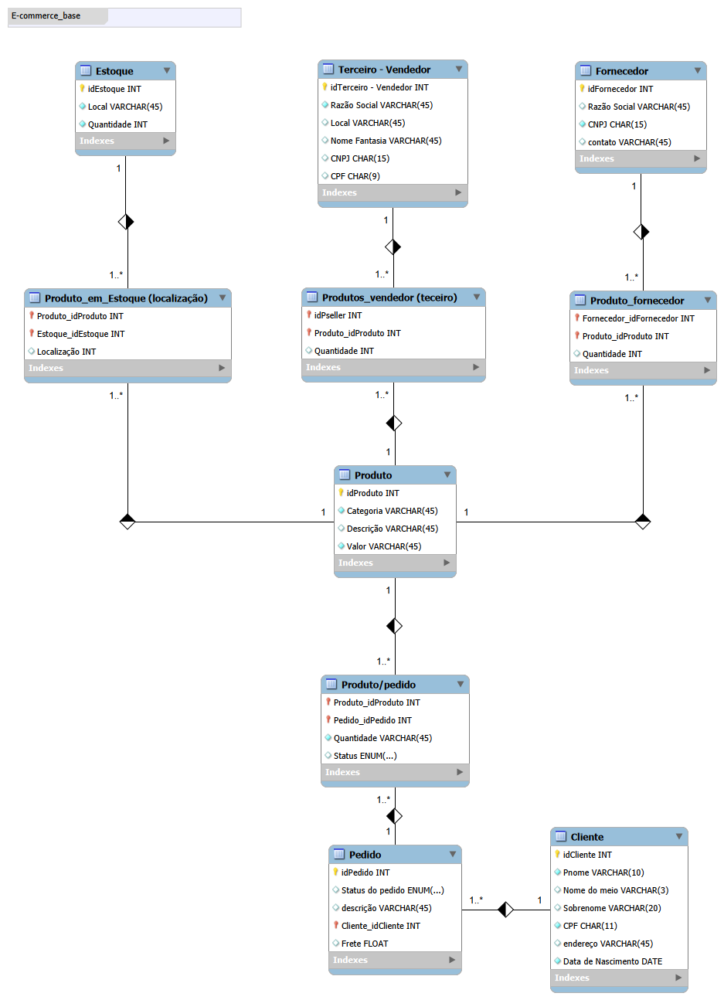
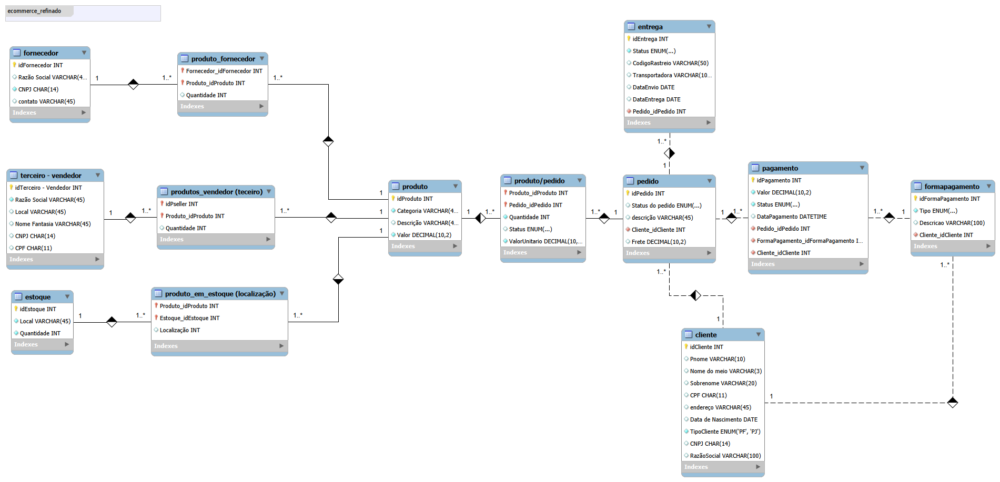

# E-commerce — Modelagem de Banco de Dados com MySQL

Banco de dados relacional para um cenário de e-commerce, com regras de integridade, cadastro de clientes pessoa física e jurídica, múltiplas formas de pagamento e acompanhamento de entregas.

O projeto reúne modelos EER, scripts de criação e inserção de dados e **18 consultas SQL** para analisar pedidos, produtos, fornecedores, pagamentos e entregas.

## 🛠️ Tecnologias

- **MySQL 8:** criação do banco, persistência de dados e consultas.
- **MySQL Workbench:** modelagem e visualização dos diagramas EER.
- **SQL:** definição de tabelas, constraints, relacionamentos e consultas analíticas.

## 🗂️ Evolução da modelagem

| Versão | Esquema | Conteúdo |
| --- | --- | --- |
| Modelo inicial | `ecommerce_base` | 10 tabelas, reproduzidas e adaptadas a partir do modelo trabalhado nas aulas. |
| Modelo ampliado | `ecommerce_refinado` | 13 tabelas, com distinção entre PF/PJ, formas de pagamento e entregas. |

O modelo inicial foi reproduzido e adaptado a partir do material de referência. O modelo ampliado incorpora os refinamentos e é utilizado pelos scripts de inserção e consultas.

## 🔐 Modelo lógico e regras de negócio

O modelo relaciona clientes, pedidos, produtos, fornecedores, vendedores e estoques. Tabelas associativas representam os produtos de cada pedido, os produtos fornecidos, os produtos vendidos por terceiros e a localização dos produtos nos estoques.

Na versão refinada:

- **Cliente PF ou PJ:** `TipoCliente` e a constraint `chk_cliente_pf_pj` impedem o preenchimento simultâneo das informações de pessoa física e jurídica. PF exige CPF e primeiro nome; PJ exige CNPJ e razão social, mantendo os campos pessoais nulos.
- **Formas de pagamento:** cada cliente pode cadastrar várias formas. Um pedido pode receber vários registros de pagamento, com valor, status e data.
- **Titularidade:** chaves estrangeiras compostas garantem que o pedido e a forma de pagamento de um pagamento pertençam ao mesmo cliente.
- **Entrega:** cada registro possui status e campos para rastreio, transportadora e datas. Um pedido pode ter mais de uma entrega; o rastreio pode ficar nulo enquanto a entrega está sendo preparada.
- **Valores monetários:** campos monetários usam `DECIMAL`; os itens guardam `ValorUnitario` para preservar o preço praticado na compra.

### 📐 Diagrama do modelo inicial

### 📐 Diagrama do modelo ampliado

## 📁 Estrutura dos arquivos

| Caminho | Finalidade |
| --- | --- |
| `base/ecommerce_base.sql` | Criação da versão base, em esquema separado. |
| `refinado/ecommerce_refinado.sql` | Criação das tabelas e constraints da versão refinada. |
| `refinado/insercao_dados.sql` | Dados fictícios para as 13 tabelas. |
| `refinado/consultas.sql` | 18 consultas comentadas com suas perguntas. |
| `base/ecommerce_base.mwb` | Modelo inicial editável no MySQL Workbench. |
| `refinado/ecommerce_refinado.mwb` | Modelo ampliado editável no MySQL Workbench. |
| `base/imagens/` e `refinado/imagens/` | Diagramas exportados em PNG, separados por versão. |

## 🚀 Como executar

Utilize **MySQL 8.0.16 ou superior**, para aplicação das constraints `CHECK`, e um cliente SQL, como o MySQL Workbench. As consultas também utilizam CTEs do MySQL 8.

1. Conecte o Workbench ao seu servidor MySQL.
2. Abra `refinado/ecommerce_refinado.sql` em **File → Open SQL Script** e execute o script completo.
3. Execute `refinado/insercao_dados.sql` uma vez, com as tabelas vazias.
4. Abra `refinado/consultas.sql` e execute as consultas individualmente para analisar seus resultados.

Os scripts selecionam o esquema com `USE ecommerce_refinado`. O script de inserção usa identificadores fixos: executá-lo novamente sobre dados já inseridos pode causar erros de chave duplicada. O script de criação não limpa um banco existente.

A versão base é opcional e independente: execute `base/ecommerce_base.sql` para criar o esquema `ecommerce_base`. Os dados e as consultas deste projeto foram preparados para a versão refinada.

Para abrir os diagramas editáveis, use **File → Open Model** e selecione o arquivo `.mwb` correspondente.

**Atenção ao modelo importado:** a constraint `chk_cliente_pf_pj` está no SQL, mas não foi preservada no `.mwb` importado do servidor. Utilize `refinado/ecommerce_refinado.sql` como referência para criar o banco com todas as regras. Gerar o SQL somente pelo `.mwb` pode omitir essa validação. Os nomes das tabelas do modelo importado podem aparecer em minúsculas, conforme a configuração do servidor de origem.

## 🔎 Consultas e perguntas de negócio

As 18 consultas contemplam `SELECT`, `WHERE`, atributos derivados, `ORDER BY`, `GROUP BY`, `HAVING`, junções e CTEs. Entre as perguntas respondidas estão:

- Quais produtos custam pelo menos R$ 200?
- Quantos pedidos foram feitos por cada cliente, incluindo clientes sem pedidos?
- Quais clientes fizeram mais de um pedido?
- Qual o subtotal dos itens e o total de cada pedido, incluindo o frete uma única vez?
- Quais pedidos ultrapassam R$ 1.000?
- Algum vendedor também é fornecedor, considerando o CNPJ?
- Quais produtos cada fornecedor fornece e onde esses produtos estão localizados?
- Quais clientes cadastraram mais de uma forma de pagamento?
- Quanto foi aprovado por tipo de pagamento e qual o saldo de cada pedido?
- Quais entregas estão em transporte e quanto tempo levaram as entregas concluídas?
- Quais itens foram comprados por preço diferente do preço atual do catálogo?

O cálculo dos saldos agrega itens e pagamentos separadamente antes de juntá-los, evitando multiplicar valores em pedidos com vários itens e vários pagamentos.

## ✅ Dados e validação

A carga contém 6 clientes, 7 pedidos, 6 produtos, 8 formas de pagamento, 9 registros de pagamento e 7 entregas, além dos fornecedores, vendedores e associações. Os documentos e demais dados são fictícios.

Durante o desenvolvimento, os scripts foram executados pela autora no MySQL local. Dois testes negativos demonstraram a aplicação das regras:

| Tentativa | Resultado observado |
| --- | --- |
| Adicionar CNPJ ao cliente PF de identificador 1 | Erro 3819: violação de `chk_cliente_pf_pj`. |
| Vincular o pagamento 1 à forma de pagamento 3, de outro cliente | Erro 1452: violação de `fk_pagamento_forma_cliente`. |

Esses erros são esperados e indicam que as alterações inválidas foram rejeitadas.

## 📝 Observações técnicas

A quantidade em `Estoque` representa o total cadastrado por depósito; a associação produto/estoque registra localização, sem quantidade individual por produto. As consultas de localização não apresentam esse total como saldo de cada produto. O modelo não automatiza baixas de estoque, conciliação financeira ou alterações de status. A regra PF/PJ verifica preenchimento e exclusividade, sem validar os dígitos verificadores de CPF/CNPJ.

## 📚 Referências e créditos

A modelagem inicial tem como referência as aulas da professora **Juliana Zanelatto**, na formação da **DIO**, incluindo o desafio *Construindo seu Primeiro Projeto Lógico de Banco de Dados*.

Referência do material da professora: [repositório mysql_sql_database_specialist — desafio do módulo 3](https://github.com/julianazanelatto/mysql_sql_database_specialist/tree/main/M%C3%B3dulo%203/desafio).

A reprodução e adaptação da versão base, os refinamentos, a carga de dados, as consultas e a organização desta entrega foram realizados como exercício de aprendizagem, com apoio do ChatGPT na elaboração e revisão dos scripts e da documentação.
